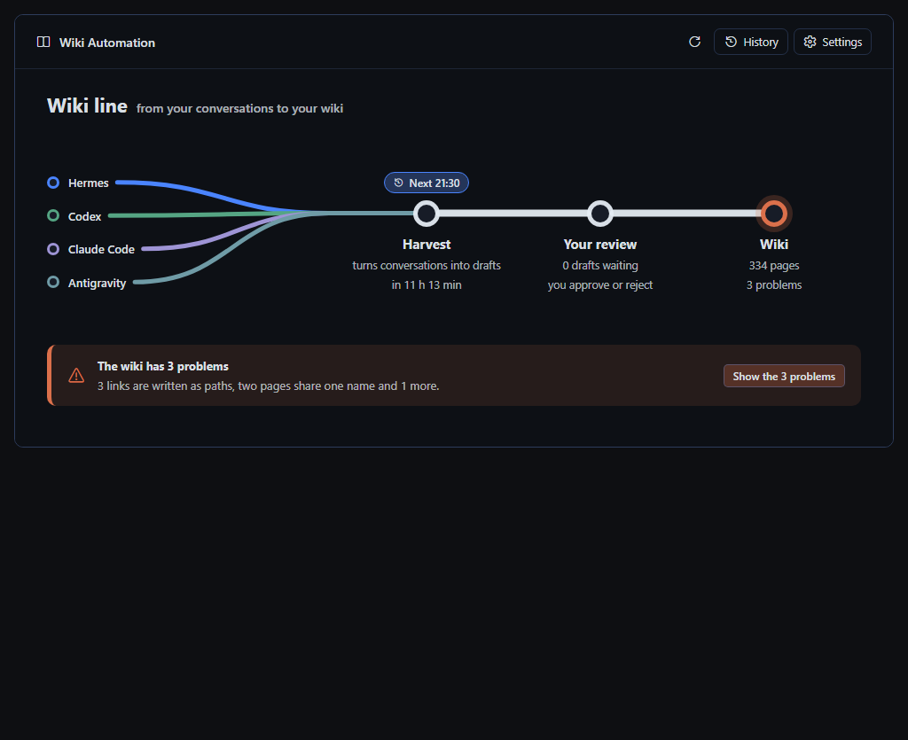
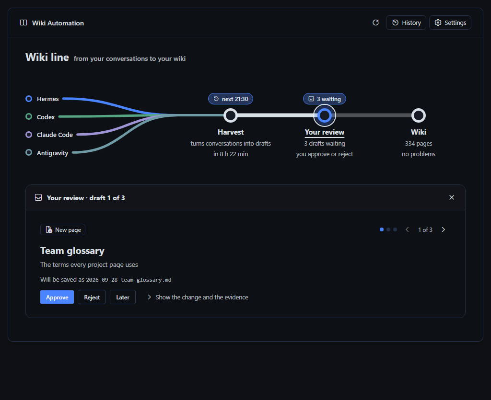
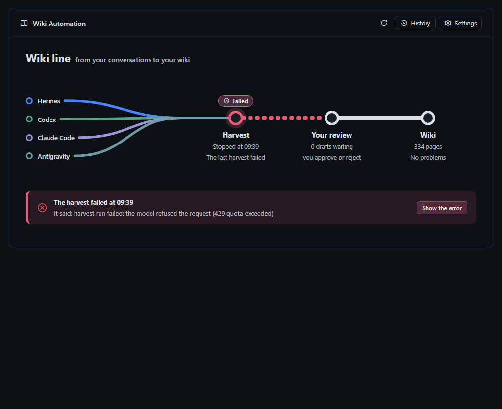
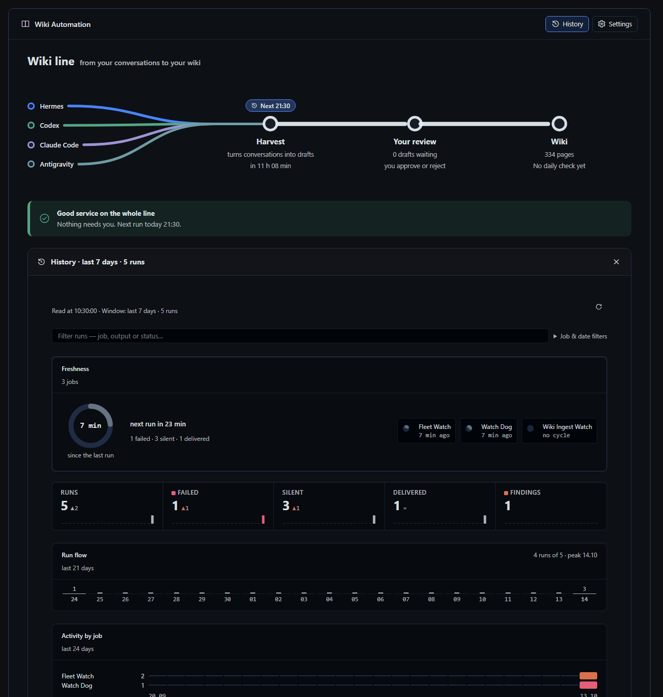
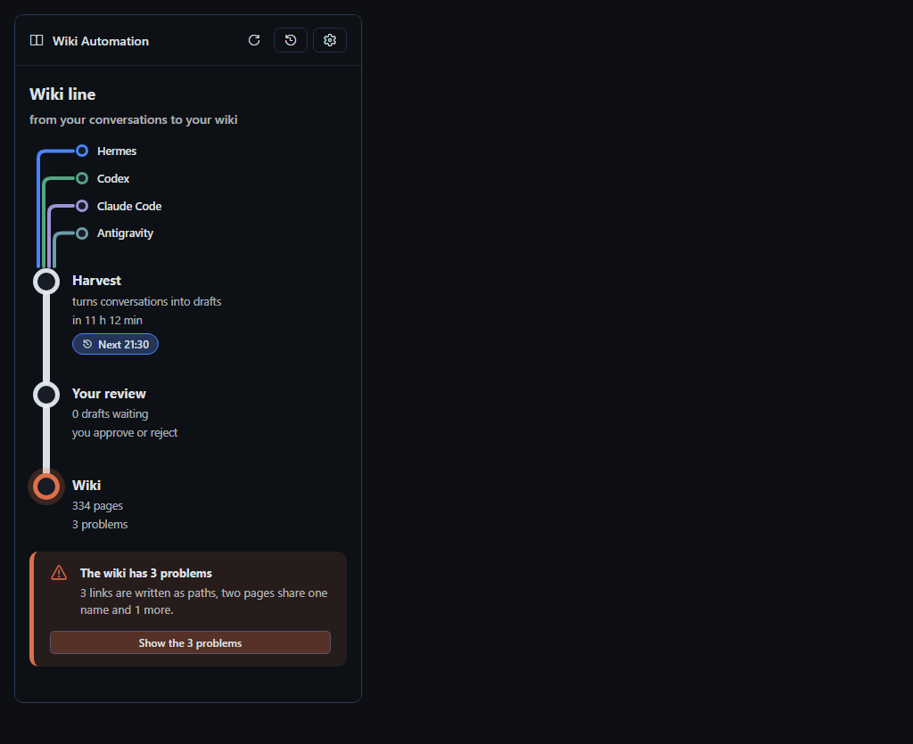

# Wiki Automation

One screen for Hermes Desktop: the Wiki line. It reads like a subway map. Four conversation sources (Hermes,
Codex, Claude Code, Antigravity) run into **Harvest**, then **Your review**, then the **Wiki**. Every station says
its state in words. One bar under the map names the most urgent thing that needs the owner, or says the whole line
is in good service. It never says that while a read failed, and a failed read keeps the backend's own error.

Click a station, a line, **History** or **Settings** and its detail opens under the map, one at a time:

- **Wiki:** problems in plain English, and **Ask Hermes to fix these**, which writes the request into the chat box
  and never sends it; the three morning jobs.
- **Harvest:** what it does, the timetable, the last run; change its time, pause or resume it.
- **A line:** what it brings and how far it has been read. A found folder does not prove every conversation was read.
- **Your review:** one draft at a time with Approve, Reject and Later. Approval stays two-step and warns about
  source writes and model usage; a rejection needs its reason. The change and its evidence are one click away.
- **History:** the run journal and its diagnostics, with search, filters and archive-before-clear.
- **Settings:** the wiki folder, the engine, the scheduled jobs and the installation files.

The binding design is [`Docs/metro-contract.md`](Docs/metro-contract.md); the approved mocks are in
`Docs/directions/metro-2.5.0/`. Host theme tokens and controls only. Under a 640 px pane the line turns vertical.

Plugin id `wiki-automation` · label **Wiki Automation** · route `/wiki-automation` · MIT.

**Read `Docs/wiki-automation-notes.md` before changing anything** — the panel and the backend carry no comments on
purpose, and that file holds the reasoning behind every rule the gates enforce.

## Screenshots

These screenshots use fixture data, not live engine state or completed ingestion.







## Install

`HERMES_HOME` is the install root: `%LOCALAPPDATA%\hermes` on Windows, `~/.hermes` otherwise.

```bash
hermes plugins install thealps01-netizen/hermes-wiki-automation --ref <40-character-commit-sha> --enable
```

Install a reviewed, CI-passing commit. For an existing installation, add `--force`; plugin-owned
state is retained. The desktop half is opt-in under **Capabilities → Plugins**.

The Desktop page loads a materialized copy under `desktop-plugins/wiki-automation/`, not directly
from the installed package. Hermes manages that copy and watches it for UI reloads. Do not edit
either installed tree by hand; update from the development repository through the pinned installer.
After a backend change, restart the desktop app to load the new Python routes. The release gate
checks that the materialized panel matches the reviewed source.

## Backend

Automation: `GET /harvest/status` (read-only engine adapter status) · `GET /automation` · `POST /automation/validate|derive|scan_root|settings` · `GET /automation/candidates` · `GET /jobs` · `POST /jobs/act` · `POST /jobs/preview` (read-only) · `GET /runs` · `GET /candidates` · `GET /candidates/show` · `POST /candidates/act`

Health (moved from the Wiki Watchdog panel in 2.0.0): `GET /health/watchdog` · `POST /health/watchdog/clear` · `GET /health/jobs` · `GET /health/jobs/run` · `POST /health/runs/archive-clear` (archives to `<HERMES_HOME>/backups/wiki-watchdog/` before it removes anything). The retired `plugins/wiki-watchdog` panel is left in place; disable it once 2.0.0 is installed.

Saves a verified root (the backend validates before it writes; a copy/mirror collision needs a second, explicit click). `POST /jobs/act` changes a verified engine job only when its `{id, state, schedule}` still equals what the page showed, checked inside Hermes' cron store lock (see Docs/draft-security.md). `POST /jobs/preview` remains read-only and uses the core's own next-run computation. The separate exact-plan engine installer preserves existing task IDs/custom schedules and creates new jobs paused; neither installation nor a review grants content-owner authority.

Engine lifecycle: `GET /engine/status` · `POST /engine/prepare|apply` · `POST /engine/recovery/prepare|apply`. New-session recovery permits only the original approved unfinished plan, the same verified administrator and a fresh, explicit, expiring confirmation. See [installation recovery](Docs/installation-session-recovery.md) and [UI boundaries](Docs/install-session-recovery-ui.md). Unsupported legacy/WAL state is refused, not silently repaired.

For the local offline package, use [the existing Desktop installation interface](INSTALLATION.md). The package includes the engine source in `engine/` (pinned by `engine-release.json`, generated by `tools/engine_release.py`) and a portable Git source; it does not require a second installer or changes to Hermes core. Content-owner setup/decisions, task activation and live application restart remain explicit operations.

## Gates

Run from `tests/` after `npm ci`. The long form — what every rule and measurement asserts — is in
[`tests/README.md`](tests/README.md).

```bash
PYTHONPATH="$HERMES_AGENT_DIR" "$HERMES_PYTHON" ../dashboard/plugin_api.py --selftest   # needs the core's cron package
python audit_static.py && python canary_audit.py && python release_gate.py
python contract_core.py && python contract_core.py --selftest
node render_metro.mjs && node render_check.mjs && node render_health.mjs
node preview.mjs   # one preview-metro-<state>.html per contract state
```

Measured in the app's own Electron (`$HERMES_ELECTRON`), for every Metro state at 1040 px and in 390 and 352 px panes:

```bash
"$HERMES_ELECTRON" shot.cjs preview-metro-<state>.html <state>-1040.png 1040
"$HERMES_ELECTRON" shot.cjs preview-metro-<state>.html <state>-390.png 1040 --frame=390
"$HERMES_ELECTRON" shot_health.cjs preview-metro-history-log.html history-560.png 560   # and 1240
"$HERMES_ELECTRON" scroll_check.cjs preview-metro-wiki.html && "$HERMES_ELECTRON" scroll_check.cjs preview-metro-history-log.html
"$HERMES_ELECTRON" pill_check.cjs preview-metro-drafts.html && "$HERMES_ELECTRON" pill_check.cjs preview-metro-history-log.html
```

Each canary injects one violation per rule, requires the audit to fail with that rule's message, and
restores the files byte for byte — a rule that has never failed is not evidence.

## Portability

| Variable | Default | What it points at |
|---|---|---|
| `HERMES_HOME` | `%LOCALAPPDATA%\hermes`, else `~/.hermes` | the install root (profiles, the installed desktop copy) |
| `HERMES_AGENT_DIR` | `<HERMES_HOME>/hermes-agent` when present | the core checkout — CSS tokens and the compiled stylesheet |
| `HERMES_PYTHON` | the core's venv, else the running interpreter | the interpreter for the backend selftest |
| `HERMES_ELECTRON` | the core's `apps/desktop/node_modules/electron` | the binary for the measured render gate |

`python env.py` prints what a run resolved. A missing piece is named (`CSS variable check skipped`,
`kit stylesheet NOT FOUND`), never silently passed.

## Continuous integration

`.github/workflows/ci.yml` runs the static audit, the canaries, the engine manifest check (`tools/engine_release.py --check`), the three jsdom render checks (`render_metro.mjs`, `render_check.mjs`, `render_health.mjs`) and the previews
on Ubuntu and Windows, against a sparse checkout of the core pinned at `CORE_SHA`. The backend selftest
and the measured Electron render need a real Hermes install and stay local — run them before a release.

## Versioning

`plugin.yaml` is the source; `dashboard/manifest.json` and the top `CHANGELOG.md` heading must match.
Release checklist: bump the three, run every gate, use the supported pinned package installer to materialize the desktop half, verify live readback, then publish/tag only with approval. Never hand-copy a provider-managed installed tree.

## License

MIT — see [LICENSE](LICENSE). Copyright (c) 2026 Muhammed Enes Alpler.
